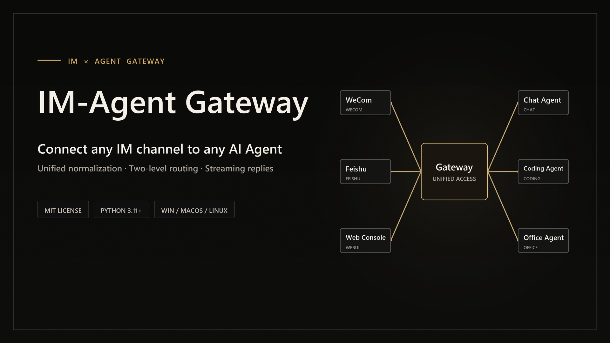
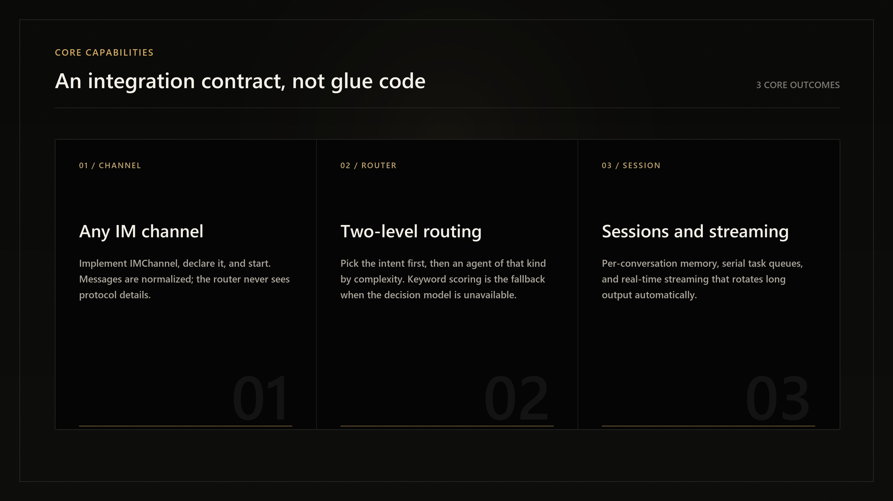

<div align="center">

# IM-Agent Gateway

[简体中文](./README.md) | English

<picture>
  <source srcset="assets/banner.en.webp" type="image/webp">
  
</picture>

[](./LICENSE)
[](https://www.python.org/)
[](https://github.com/RichardLitt/standard-readme)

</div>

Connect IM channels to multiple AI agents with unified normalization, smart routing, and streaming replies.

The platform is built around one integration contract: add an IM by implementing `IMChannel`, add an agent by implementing `BaseAgent`, then declare it in `.env`. The gateway, router, and management layers never hard-code a specific channel or agent. The bundled channels and agents work out of the box and double as reference implementations.

## Table of Contents

- [Background](#background)
- [Install](#install)
- [Quick Start](#quick-start)
- [Core Capabilities](#core-capabilities)
- [How It Works](#how-it-works)
- [Built-in Implementations](#built-in-implementations)
- [Using in IM](#using-in-im)
- [Adding an IM Channel](#adding-an-im-channel)
- [Adding an Agent](#adding-an-agent)
- [Configuration](#configuration)
- [Wake on Message](#wake-on-message)
- [Web Console](#web-console)
- [CLI Reference](#cli-reference)
- [Behavior Notes](#behavior-notes)
- [FAQ](#faq)
- [Project Layout](#project-layout)
- [Maintainer](#maintainer)
- [Contributing](#contributing)
- [License](#license)

## Background

Connecting AI to IM usually means writing a separate layer of glue for every IM and every agent: parsing different message formats, maintaining long connections, decoding streamed output, and keeping per-conversation context. Change one channel or one agent, and most of that work has to be redone.

This project moves that repeated work into the platform. Each IM and each agent only handles what it is good at and plugs into the gateway through a shared contract. Adding a new implementation requires no changes to existing platform code.

## Install

```bash
git clone https://github.com/white8tterfly/IM-Agent-Gateway.git
cd IM-Agent-Gateway
python -m venv .venv
pip install -r requirements.txt
```

Requires Python 3.11 or later. Windows, macOS, and Linux are supported. See [requirements.txt](./requirements.txt) for the dependency list.

The Qoder, WorkBuddy, and Trae agents depend on their own external CLI tools. When a CLI is missing, that agent is registered as unavailable and does not affect the platform or other implementations.

## Quick Start

### 1. Prepare the configuration

```bash
cp .env.example .env
```

Declare at least the channels and agents to load:

```env
CHANNELS = "wecom,feishu"
AGENTS   = "siliconflow,qoder,workbuddy,trae"
```

Credentials for each channel and agent are documented in [.env.example](./.env.example). Implementations whose prerequisites are not met are registered as unavailable.

Configuration priority: system environment variables > parent-directory `.env` > project `.env` > code defaults. The project `.env` is ignored by `.gitignore`; to keep credentials outside the repository, write them to the parent-directory `.env` instead.

### 2. Start

```bash
python main.py
```

You can also run `run.bat`. Logs go to both the console and `logs/im_agent_gateway.log`.

Double-clicking the "IM-Agent Gateway" desktop shortcut opens a startup window: the service runs in the background without a console, opens the Web console once it is ready (when enabled), then the window closes itself. Startup failures or an already-running instance are reported right in that window. Logs still go to `logs/im_agent_gateway.log`.

While the service runs, an "IM-Agent Gateway" tray icon appears in the notification area. Right-click it to open the Web console or chat console, or choose "退出服务" to shut down gracefully (same as `Ctrl+C`, closing IM connections first). The tray needs `pystray`; if it is missing, the service still starts, just without the icon.

The first run of `run.bat` creates an "IM-Agent Gateway" desktop shortcut once, with its own icon. After that the shortcut is never created or modified again, whether it still exists or not. To rebuild it with the latest arguments, run `create_shortcut.bat` or `powershell -ExecutionPolicy Bypass -File scripts\install_shortcut.ps1 -Force`.

### 3. Verify

- Send a direct message to the bot and expect an agent reply.
- The web console is enabled by default: open `http://127.0.0.1:8790` for the admin console (set `WEBUI_ENABLED=0` to disable it), or run `python manage.py webui` to open it in your default browser.
- In another terminal, run `python manage.py status` to confirm the service is online.

## Core Capabilities

<picture>
  <source srcset="assets/features.en.webp" type="image/webp">
  
</picture>

| Capability | Description |
| --- | --- |
| Any IM channel | Implement `IMChannel` and declare it; messages are normalized into `InboundMessage`, and the router never sees protocol details |
| Any agent | Implement `BaseAgent` and declare it; the platform exposes a shared `submit / stop / reset / busy` interface with per-conversation concurrency control |
| Two-level routing | Decide the message intent (chat / coding / office) first, then pick an agent of that kind by task complexity; falls back to keyword scoring when the decision model is unavailable |
| Framework commands | `/agent`, `/help`, `/status`, and `/webui` come from the platform; agent-specific commands are declared by each agent |
| Streaming replies | A shared streaming interface; IMs without streaming support automatically fall back to sending a whole message |
| Sessions and queues | Each IM conversation keeps separate memory per agent; tasks within a conversation run serially and new messages queue up |
| Wake on message | Optional: keep only a lightweight standby process after login, start the full service when a message arrives, and return to standby when idle |
| Web console | Optional: an admin console and a chat console; the browser behaves like a third IM |
| Multiple management entries | IM commands, the web console, and the local CLI share one management command layer, and changes are written back to `.env` |
| Access control | Restrict users by ID; whether edit operations are auto-accepted is decided by each agent's permission mode |

## How It Works

1. An IM channel parses the incoming payload, strips the @ prefix, and raises a normalized `InboundMessage` to the gateway.
2. The router decides the intent first; if only one agent of that kind is enabled it is used directly, otherwise an agent is chosen within that kind by complexity or declaration order.
3. The selected agent runs the task through `submit`, and every user-visible chunk is raised through `on_output`.
4. The channel pushes replies through `send_stream`; when the service stays idle beyond the threshold it exits and the standby process takes over again.

## Built-in Implementations

| Type | Name | Description |
| --- | --- | --- |
| IM channel | Feishu `feishu` | Messages over a self-built app long connection |
| IM channel | WeCom `wecom` | Messages over an intelligent bot long connection |
| IM channel | Web console `webui` | Local HTTP + WebSocket, admin console and chat console |
| Agent | SiliconFlow `siliconflow` | Chat: OpenAI-compatible API, SSE streaming, multi-turn history |
| Agent | Qoder `qoder` | Coding: CLI subprocess, session management, output parsing |
| Agent | WorkBuddy `workbuddy` | Office: CLI subprocess, session resumption, streaming parsing |
| Agent | Trae `trae` | Coding: open-source CLI, task progress and result extraction |

Availability depends on credentials and external CLI installation. When prerequisites are missing, the implementation is shown as unavailable without affecting the others.

## Using in IM

| Action | Description |
| --- | --- |
| Send a direct message | Auto-routing picks an agent by intent and complexity; falls back to keyword scoring when the decision model is unavailable |
| Mention the bot in a group | Send `@bot-name task description`; the channel strips the @ prefix |
| `/agent <name>` / `/agent auto` | Pin the conversation to an agent / restore auto-routing |
| `/agent on\|off <name>` | Enable or disable an agent at runtime without restarting |
| `/help` / `/status` | Show help (grouped by agent) / show service status |
| `/webui` | Get the web console URLs (admin and chat) directly in the conversation, ready to open |
| Agent-specific commands | Provided by each agent (such as `/cd`, `/ws`, `/model`, `/stop`, `/reset`); whoever receives the message handles it |

Agent switching and toggling are provided by the platform. All other commands are declared by each agent; unsupported commands return an unknown-command notice.

Each user receives a short command hint on their first message (only once per user, tracked in `.first_use.json`). Set `FIRST_USE_GUIDE=0` to disable it.

## Adding an IM Channel

1. Create a class that extends `IMChannel` and implements `start`, `close`, `send_text`, and `send_stream`. Normalize incoming payloads into `InboundMessage` and raise them through `self.on_message(...)`.
2. Put bundled channels under `im_agent_gateway/gateway/channels/<name>/` and third-party channels in your own package; both must expose a `Channel` class.
3. Declare it in `CHANNELS` in `.env` using either the short name or `module.path:ClassName`, for example `CHANNELS = "wecom,mycorp.myim:Channel"`.
4. Keep the constructor signature `Channel(cfg)` and read credentials from `cfg` or environment variables.
5. Run `python scripts/test_channel_contract.py` to verify the contract, and compare with [examples/im_channel_example.py](./examples/im_channel_example.py) for the full path from payload to reply.

<details>
<summary>Interface members and integration checklist</summary>

| Member | Required | Description |
| --- | --- | --- |
| `name` | Yes | Unique channel identifier used during registration and in the message `im` field |
| `start()` / `close()` | Yes | Establish and maintain the long connection / shut down gracefully |
| `send_text(msg, content)` | Yes | Send a text reply |
| `send_stream(msg, stream_id, content, finish)` | Yes | Send or refresh a streaming message; may send the whole message when streaming is unsupported |
| `send_welcome(evt, content)` | No | Welcome message for a new conversation; defaults to `send_text` |
| `send_push(msg, content)` | No | Push by `chat_id` / `chat_type`, used to deliver results after wake-on-message |
| `wake_listen` | No | Whether the standby process may listen to this channel independently; set `False` for HTTP-driven channels |

- [ ] The class extends `IMChannel` and the module exposes `Channel`.
- [ ] The @ prefix is stripped in the channel layer and `content` is plain text.
- [ ] Direct and group conversations set the correct `chat_id` and `chat_type`.
- [ ] The long connection reconnects on its own and stops after `close()`.
- [ ] Message callbacks go only through `self.on_message`, never directly to the router.
- [ ] The channel is declared in `CHANNELS` and `python manage.py config check` reports no channel issues.

</details>

## Adding an Agent

1. Create a class that extends `BaseAgent`, declares `name`, `label`, and `kind`, and implements `submit`, `stop`, `reset`, and `busy`.
2. Put bundled agents under `im_agent_gateway/agents/<name>/` and third-party agents in your own package; both must expose an `Agent` class.
3. Declare it in `AGENTS` in `.env` using either the short name or `module.path:ClassName`, for example `AGENTS = "siliconflow,mycorp.myagent:Agent"`.
4. If needed, set its intent with `AGENT_KINDS` and its complexity tier with `AGENT_COMPLEXITY`.
5. Run `python scripts/test_agent_contract.py` to verify the contract, and compare with [examples/agent_example.py](./examples/agent_example.py) for sessions, queues, streaming, and command handling.

<details>
<summary>Interface members and integration checklist</summary>

| Member | Required | Description |
| --- | --- | --- |
| `name` / `label` | Yes | Registration name (used by routing and `/agent`) / display name (shown in help and status) |
| `kind` | Yes | Intent: `chat` / `coding` / `office`; the first level of routing |
| `submit(chat_key, query, cwd, on_output, model)` | Yes | Submit a task and return a Future resolved when the task ends; every user-visible chunk must be raised through `on_output` |
| `stop(chat_key)` / `reset(chat_key)` | Yes | Stop the current task / clear the conversation memory |
| `busy(chat_key)` | Yes | Whether the conversation has a running or queued task |
| `available` | No | Whether prerequisites are met; unavailable agents cannot be enabled |
| `complexity` | No | Complexity tier: `simple` / `mid` / `complex`, used when several agents share an intent |
| `routing_hint` | No | Description used for routing candidates; derived from `kind` when empty |
| `commands()` / `handle_command()` | No | Agent-specific commands; the platform dispatches them and lists them in help |
| `list_models()` / `default_model` / `cwd_for()` / `close()` | No | Model list / default model / working directory / resource cleanup |

- [ ] The class extends `BaseAgent` and the module exposes `Agent`.
- [ ] All user-visible output, including the final result, is raised through `on_output`.
- [ ] `submit` returns a Future and finishes with `AgentResult`.
- [ ] Concurrent tasks on the same `chat_key` are serialized by the agent itself.
- [ ] `available` reflects missing CLIs, missing credentials, and other prerequisites.
- [ ] The agent is declared in `AGENTS` and can be seen and toggled in `python manage.py agents`.

</details>

## Configuration

`CHANNELS` and `AGENTS` are comma-separated lists. Each entry is either a short name (a bundled directory) or `module.path:ClassName` (any third-party package). The loader checks that each entry implements the corresponding base class and fails at startup otherwise. `ENABLED_AGENTS` only sets the initial switch state; it does not affect loading.

| Common setting | Description | Default |
| --- | --- | --- |
| `LANGUAGE` | UI language: `zh` Chinese / `en` English for pages and bot replies | `zh` |
| `CHANNELS` | IM channels to load | `wecom,feishu` |
| `AGENTS` | Agents to load | `siliconflow,qoder,workbuddy,trae` |
| `DEFAULT_AGENT` | Fallback agent when auto-routing is unavailable | `siliconflow` |
| `AUTO_ROUTE` | Enable auto-routing | `1` |
| `WEBUI_ENABLED` | Enable the web console | `1` |
| `FIRST_USE_GUIDE` | Send a short command hint on the first message from a user | `1` |
| `WATCH_ENABLED` | Master switch for wake-on-message | `0` |
| `ALLOWED_USERS` | User allowlist; empty means unrestricted | empty |

See [.env.example](./.env.example) for every setting, its default, and its purpose. Configuration can be changed three equivalent ways: edit `.env`, use the web console, or run `python manage.py config set <key> <value>`. Chinese and English can be switched at any time from the top-right corner of the admin and chat pages; the choice is written back to `LANGUAGE` and takes effect immediately.

```bash
python manage.py config show    # show the effective configuration
python manage.py config check   # check channel requirements, allowlist, and agent prerequisites
```

## Wake on Message

Disabled by default. When enabled, three independent switches control it:

| Switch | Used by | Description |
| --- | --- | --- |
| `WATCH_ENABLED` | `watcher.py` | Master switch: `1` = the standby process listens and wakes the service; `0` = exit immediately |
| `WATCH_AUTOSTART` | `watcher.py` | Start at login: `1` = start silently at login (default); `0` = do not start at login (takes effect next boot) |
| `IDLE_EXIT` | `main.py` | Idle exit: `1` = exit after `IDLE_EXIT_MIN` minutes without messages; `0` = stay resident |

How it works: the standby process loads only the channels. When a message arrives it first sends a placeholder reply, writes the message to a handoff file, and then starts the full service. The service reads the handoff file, processes the message again, and delivers the result through `send_push`. Once idle beyond the threshold it exits and the standby process takes over again.

Windows autostart:

```powershell
powershell -ExecutionPolicy Bypass -File scripts\install_watcher.ps1             # install
powershell -ExecutionPolicy Bypass -File scripts\install_watcher.ps1 -Uninstall  # uninstall
```

The scheduled task starts the standby process with `pythonw.exe`, and starts the service and probe processes with the no-window flag, so no console window appears at login. With `WATCH_ENABLED=1`, let the standby process hold the connection instead of running `main.py` for long periods; the two would compete for the same bot connection.

## Web Console

Enabled by default. When enabled, the browser behaves like a third IM and shares routing, allowlist, and queue behavior with bot messages.

| Switch | Default | Description |
| --- | --- | --- |
| `WEBUI_ENABLED` | `1` | `1` = load the webui channel and serve the admin and chat consoles; `0` = do not load |
| `WATCH_HTTP_ENABLED` | `0` | `1` = while the service sleeps, the standby process holds the port, serves the pages, and offers one-click wake (requires `WATCH_ENABLED=1`) |

| Page | URL | Purpose |
| --- | --- | --- |
| Admin console | `http://127.0.0.1:8790` | Runtime status, channel connections, idle countdown, agent switches, tasks, logs, configuration |
| Chat console | `http://127.0.0.1:8790/chat.html` | Chat with agents from the browser, with auto-routing, commands, memory, queues, and streaming |

The webui channel and the sleep-state host share the port, so only one process uses it at a time. HTTP binds to `127.0.0.1` only; admin endpoints and the chat WebSocket require a session token generated at service start and validate Host / Origin, preventing arbitrary websites from calling the local API cross-site. The chat console uses `WEBUI_USER_ID` (default `webui`), which must be included in `ALLOWED_USERS` when an allowlist is set.

If you do not know the console address, run `python manage.py webui`: when the page is reachable it opens the admin console in your default browser and prints the chat console URL; when the service is not running it tells you to start it first. On a remote terminal, `python manage.py webui --no-open` only prints the addresses. You can also send `/webui` in Feishu, WeCom, or any other IM conversation, and the bot replies with the admin and chat links.

## CLI Reference

`manage.py` is the local management entry point. It shares one command layer and validation rules with IM commands and the web console. Offline commands read and write the project `.env` directly and do not need a running service. Online commands call the local management endpoint and require `WEBUI_ENABLED=1` with the service running.

| Command | Needs service | Description |
| --- | --- | --- |
| `python manage.py config show` | No | Show the effective configuration grouped as common / advanced, with secrets hidden |
| `python manage.py config check` | No | Check channel requirements, allowlist conflicts, and agent prerequisites |
| `python manage.py config set <key> <value>` | No | Change a setting and write it back to `.env` |
| `python manage.py status` | Yes | Service status, channel connections, agent counts, idle countdown |
| `python manage.py webui [--no-open]` | Yes | Open the web console in the default browser and print the admin and chat URLs |
| `python manage.py agents` | Yes | Agent list with intent, complexity tier, switch state, and availability |
| `python manage.py agent on\|off <name>` | Yes | Enable or disable an agent, write it back to `.env`, and keep it across restarts |

```bash
python manage.py config set DEFAULT_AGENT workbuddy
python manage.py agent off qoder
python manage.py status
python manage.py webui
```

Rules for configuration changes:

- Keys are case-insensitive and normalized to uppercase.
- Only keys registered in the configuration metadata can be written, which prevents typos.
- Leaving a secret empty keeps its current value instead of clearing it.
- Changes are saved to the project `.env`, preserving comments and order; missing keys are appended.
- Settings that support hot reload report "the running service will pick up the new value immediately"; others report "takes effect after restart".

Exit codes: `0` means the command completed (including `config check` finding problems); `1` means configuration loading failed, such as a missing required channel credential.

## Behavior Notes

- **Routing**: the first level decides the intent and is skipped when only one enabled agent covers it. The second level picks an agent within that intent: a single agent is used directly; with several, `COMPLEXITY_ROUTE=1`, and configured tiers, complexity decides; otherwise the first in declaration order wins. If the decision fails, the first level falls back to keyword scoring.
- **Agent switches**: initialized from `ENABLED_AGENTS` at startup and changeable at runtime; when all agents are off, messages ask the user to enable one.
- **Session memory**: direct messages are keyed by user ID and group messages by group ID, separately per agent; `/reset` clears the current agent's memory.
- **Task queues**: tasks in one conversation run serially and new messages queue up. Coding and office agents default to one global task at a time to avoid concurrent edits in the same directory.
- **Streaming**: output is pushed as it is produced; very long output rotates messages to fit each IM's streaming window limits.
- **Usage summary**: task completion includes the agent, model, and usage (tokens / cost); when usage data is unavailable it shows only the agent and model.
- **Security**: whether file edits are auto-accepted is decided by each agent's permission mode; use `ALLOWED_USERS` to restrict access.

## FAQ

- **Repeated reconnects**: some IMs allow only one long connection. Make sure no other process subscribes to the same account; with wake-on-message, only one of the standby process and the service may hold the connection at a time.
- **The service does not start after enabling wake-on-message**: confirm `WATCH_ENABLED=1`, `WATCH_AUTOSTART=1`, and that `scripts\install_watcher.ps1` has been installed; then check `logs/im_agent_gateway.log`.
- **Garbled replies or timeouts**: check `logs/im_agent_gateway.log`; increase the agent timeout setting if needed.
- **Chat is unavailable**: confirm the chat agent's API key is valid and `python manage.py config check` reports no missing items.
- **An agent shows as unavailable**: prerequisites are not met (CLI not installed, not signed in, or credentials missing). After fixing them, run `python manage.py agent on <name>`.
- **The web console does not open**: confirm `WEBUI_ENABLED=1`, the service is running, and the port is free. Run `python manage.py webui` first; if it reports that the service is not running, start it with `python main.py` or `run.bat`. To keep the page reachable and support one-click wake while the service sleeps, enable both `WATCH_ENABLED=1` and `WATCH_HTTP_ENABLED=1`.

## Project Layout

```text
main.py                 Service entry: assembles the gateway, router, and agents from .env
watcher.py              Standby entry: wake-on-message and sleep-state hosting
manage.py               Local management CLI entry
im_agent_gateway/
  config.py             Configuration loading (layered .env, intent and tier overrides, hot reload)
  plugins.py            Declaration parsing: short names and "module.path:ClassName"
  gateway/              Gateway layer: IMChannel base, channel registry, handoff, sleep-state host
    channels/           Bundled channels: wecom, feishu, webui
  router/               Router layer: two-level decisions, keyword fallback, command dispatch, idle check
  agents/               Agent system: BaseAgent, registry, and bundled implementations
  manage/               Management command layer shared by CLI, web console, and IM commands
webui/                  Web console pages (admin, chat, styles, scripts)
assets/                 README visual assets
examples/               Runnable examples for channels and agents
scripts/                Autostart scripts and per-module test scripts
docs/spec/              Feature specifications
```

Each `test_*.py` under `scripts/` runs independently:

```bash
python scripts/test_channel_contract.py
python scripts/test_agent_contract.py
```

## Maintainer

[white8tterfly](https://github.com/white8tterfly)

## Contributing

Issues and pull requests are welcome. Open an issue for questions, bug reports, or feature discussions.

Before submitting, run the relevant test scripts and make sure `.env`, logs, local paths, and credentials are not committed. Write commit messages in Chinese, explain what changed and why, and keep one logical change per commit.

## License

[MIT](./LICENSE) (c) 2026 IM-Agent Gateway Contributors
