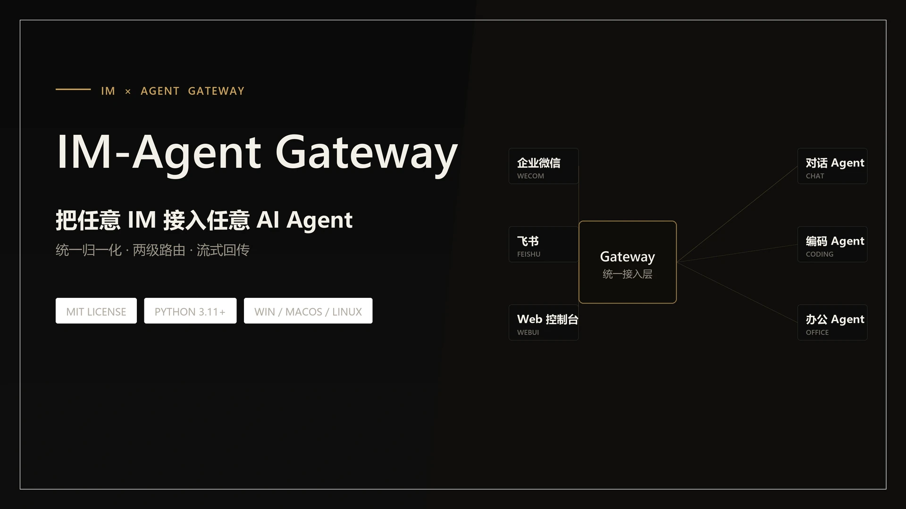
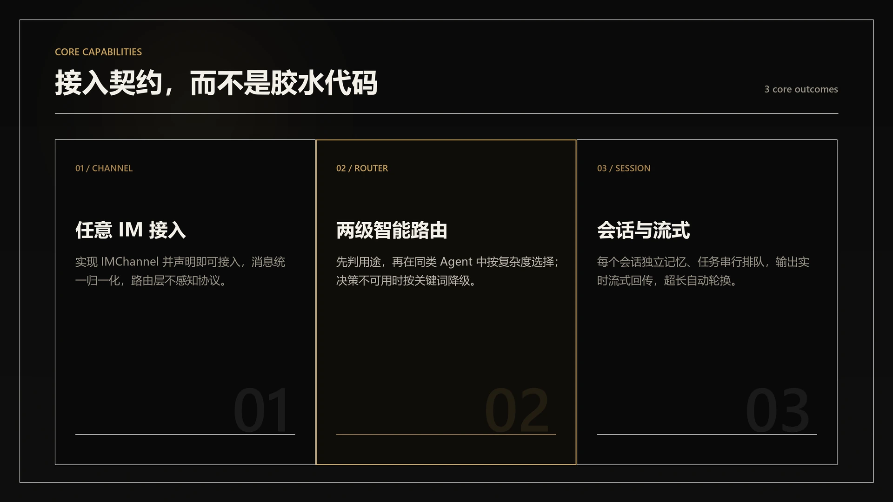

<div align="center">

# IM-Agent Gateway

简体中文 | [English](./README.en.md)

<picture>
  <source srcset="assets/banner.webp" type="image/webp">
  
</picture>

[](./LICENSE)
[](https://www.python.org/)
[](https://github.com/RichardLitt/standard-readme)

</div>

把企业微信、飞书、Web 控制台等 IM 通道接入多个 AI Agent，统一完成消息归一化、智能路由与流式回传。

平台的核心是一条接入契约：新增 IM 只实现 `IMChannel`，新增 Agent 只实现 `BaseAgent`，在 `.env` 中声明即可加载。网关、路由与管理层不硬编码任何具体通道或 Agent。仓库内置的三种通道与四种 Agent 可以直接使用，也可以作为接入新实现的参考。

## 目录

- [背景](#背景)
- [安装](#安装)
- [快速开始](#快速开始)
- [核心能力](#核心能力)
- [工作方式](#工作方式)
- [内置实现](#内置实现)
- [IM 使用](#im-使用)
- [接入 IM 通道](#接入-im-通道)
- [接入 Agent](#接入-agent)
- [配置](#配置)
- [消息唤醒](#消息唤醒)
- [Web 控制台](#web-控制台)
- [命令行手册](#命令行手册)
- [行为说明](#行为说明)
- [常见问题](#常见问题)
- [目录结构](#目录结构)
- [维护者](#维护者)
- [参与贡献](#参与贡献)
- [许可证](#许可证)

## 背景

把 AI 接进 IM 时，常见做法是每个 IM 与每个 Agent 之间各写一套胶水代码：处理各不相同的报文格式、维护长连接、解析流式输出、保存会话上下文。通道或 Agent 一换，这部分工作几乎要重做一遍。

本项目把这些重复工作收敛到平台层。IM 与 Agent 各自只负责自己擅长的事，通过统一契约挂到网关上；新增实现不需要改动平台任何现有代码。

## 安装

```bash
git clone https://github.com/white8tterfly/IM-Agent-Gateway.git
cd IM-Agent-Gateway
python -m venv .venv
pip install -r requirements.txt
```

要求在 Python 3.11 及以上运行，Windows、macOS、Linux 均可。依赖清单见 [requirements.txt](./requirements.txt)。

Qoder、WorkBuddy、Trae 三种 Agent 依赖各自的外部命令行工具。未安装时它们会自动注册为不可用，不影响平台与其他实现运行。

## 快速开始

### 1. 准备配置

```bash
cp .env.example .env
```

至少声明要接入的通道与 Agent：

```env
CHANNELS = "wecom,feishu"
AGENTS   = "siliconflow,qoder,workbuddy,trae"
```

各通道与 Agent 所需的凭证见 [.env.example](./.env.example) 注释。前置条件不满足的实现会自动注册为不可用。

配置优先级为：系统环境变量 > 上一级目录 `.env` > 项目 `.env` > 代码默认值。项目 `.env` 已被 `.gitignore` 忽略；希望把凭证放在仓库之外时，也可以写入上一级目录的 `.env`。

### 2. 启动

```bash
python main.py
```

也可以双击 `run.bat`。日志同时输出到控制台与 `logs/im_agent_gateway.log`。

不希望出现命令行窗口时，双击桌面上的「IM-Agent Gateway」快捷方式：它用 `pythonw.exe` 后台启动，日志同样写入 `logs/im_agent_gateway.log`；重复启动会被单实例锁挡住，不会与已有实例抢连接。

首次运行 `run.bat` 时会在桌面创建一次「IM-Agent Gateway」快捷方式（带专用图标），之后不论它是否还在都不再创建或修改；需要强制重建时，双击 `create_shortcut.bat`，或执行 `powershell -ExecutionPolicy Bypass -File scripts\install_shortcut.ps1 -Force`。

### 3. 验证

- 给机器人发一条单聊消息，应收到 Agent 回复。
- Web 控制台默认开启，访问 `http://127.0.0.1:8790` 打开管理台（设 `WEBUI_ENABLED=0` 可关闭）；也可以执行 `python manage.py webui` 自动打开浏览器。
- 另开终端执行 `python manage.py status`，确认服务在线。

## 核心能力

<picture>
  <source srcset="assets/features.webp" type="image/webp">
  
</picture>

| 能力 | 说明 |
| --- | --- |
| 多 IM 接入 | 实现 `IMChannel` 并声明即可接入；报文统一归一化为 `InboundMessage`，路由层不感知具体协议 |
| 多 Agent 接入 | 实现 `BaseAgent` 并声明即可接入；统一 `submit / stop / reset / busy` 接口，会话级并发控制 |
| 两级智能路由 | 先判定消息用途（对话 / 编码 / 办公），再在同类 Agent 中按问题复杂度选择；决策模型不可用时退化为关键词计分 |
| 框架命令 | `/agent`、`/help`、`/status`、`/webui` 由平台提供；Agent 特有指令由各 Agent 声明 |
| 流式回复 | 平台定义统一流式接口；不支持流式的 IM 自动退化为整条发送 |
| 会话与队列 | 每个 IM 会话分别维护各 Agent 的会话记忆；同一会话内任务串行，期间新消息自动排队 |
| 消息唤醒 | 可选：登录后只运行轻量待命进程监听消息，收到消息再启动完整服务，空闲后自动退回 |
| Web 控制台 | 可选：管理台与聊天台，浏览器相当于第三个 IM |
| 多入口管理 | IM 指令、Web 管理台、本地 CLI 共用同一管理命令层，改动一致写回 `.env` |
| 权限控制 | 可按用户 ID 限制使用者；是否自动接受编辑操作由各 Agent 的权限模式决定 |

## 工作方式

1. IM 通道收到报文后完成协议解析与 @ 前缀剥离，归一化为 `InboundMessage` 上抛给网关。
2. 路由层先判定用途；只有一种用途的 Agent 开启时直接使用，否则在该用途内按复杂度或声明顺序选择。
3. 选中的 Agent 以 `submit` 执行任务，用户可见的每一段输出都通过 `on_output` 上抛。
4. 通道通过 `send_stream` 实时推送；服务空闲超过阈值后退出，待命进程重新接管监听。

## 内置实现

| 类型 | 名称 | 说明 |
| --- | --- | --- |
| IM 通道 | 飞书 `feishu` | 企业自建应用长连接收发消息 |
| IM 通道 | 企业微信 `wecom` | 智能机器人长连接收发消息 |
| IM 通道 | Web 控制台 `webui` | 本机 HTTP + WebSocket，管理台与聊天台 |
| Agent | SiliconFlow `siliconflow` | 对话：OpenAI 兼容接口、SSE 流式、多轮历史 |
| Agent | Qoder `qoder` | 编码：CLI 子进程、会话管理、输出解析 |
| Agent | WorkBuddy `workbuddy` | 办公：CLI 子进程、会话续接、流式解析 |
| Agent | Trae `trae` | 编码：开源 CLI，任务进度与结果提取 |

能否使用取决于各自的凭证与外部 CLI 安装情况；条件不满足时显示为不可用，不影响其他实现运行。

## IM 使用

| 操作 | 说明 |
| --- | --- |
| 单聊直接发消息 | 自动路由：按用途与问题复杂度两级选择 Agent，决策不可用时按关键词降级 |
| 群里 @机器人 | 发送 `@机器人名 任务描述`，@ 前缀由通道层剥离 |
| `/agent <名称>` / `/agent auto` | 固定到某个 Agent / 恢复自动路由 |
| `/agent on\|off <名称>` | 运行时开启或关闭 Agent，无需重启 |
| `/help` / `/status` | 查看帮助（含各 Agent 指令分组）/ 查看服务状态 |
| `/webui` | 在对话里获取 Web 控制台地址（管理台与聊天台），点击即可打开 |
| Agent 特有指令 | 由各 Agent 提供（如 `/cd`、`/ws`、`/model`、`/stop`、`/reset`），消息路由到谁就由谁处理 |

切换与开关 Agent 的命令由平台提供，其余指令由各 Agent 自行声明；不支持的指令会提示未知命令。

## 接入 IM 通道

1. 新建类继承 `IMChannel`，实现 `start`、`close`、`send_text`、`send_stream`；收到报文时归一化为 `InboundMessage`，通过 `self.on_message(...)` 上抛。
2. 内置通道放到 `im_agent_gateway/gateway/channels/<名称>/`，第三方通道放在自己的包中，均需暴露 `Channel` 类。
3. 在 `.env` 的 `CHANNELS` 中写入短名或 `模块路径:类名`，例如 `CHANNELS = "wecom,mycorp.myim:Channel"`。
4. 构造函数签名固定为 `Channel(cfg)`，所需凭证从 `cfg` 或环境变量读取。
5. 运行 `python scripts/test_channel_contract.py` 校验契约；对照 [examples/im_channel_example.py](./examples/im_channel_example.py) 观察完整链路。

<details>
<summary>接口成员与接入检查清单</summary>

| 成员 | 必须 | 说明 |
| --- | --- | --- |
| `name` | 是 | 通道唯一标识，注册与消息的 `im` 字段使用 |
| `start()` / `close()` | 是 | 建立并维持长连接 / 优雅断开 |
| `send_text(msg, content)` | 是 | 回复文本 |
| `send_stream(msg, stream_id, content, finish)` | 是 | 发送或刷新流式消息；不支持时可整条发送 |
| `send_welcome(evt, content)` | 否 | 进入会话的欢迎语，默认退化为 `send_text` |
| `send_push(msg, content)` | 否 | 按 `chat_id` / `chat_type` 主动回传，用于消息唤醒后的结果回传 |
| `wake_listen` | 否 | 是否允许待命进程独立监听该通道；HTTP 被动型通道设为 `False` |

- [ ] 类继承 `IMChannel`，模块暴露 `Channel`。
- [ ] 群聊 @ 前缀已在通道层剥离，`content` 是纯文本。
- [ ] 单聊与群聊分别填入正确的 `chat_id`、`chat_type`。
- [ ] 长连接断开后能自行重连，`close()` 后不再重连。
- [ ] 消息回调只经 `self.on_message` 上抛，不直接调用路由。
- [ ] 已在 `CHANNELS` 声明，且 `python manage.py config check` 无通道级问题。

</details>

## 接入 Agent

1. 新建类继承 `BaseAgent`，声明 `name`、`label`、`kind`，实现 `submit`、`stop`、`reset`、`busy`。
2. 内置 Agent 放到 `im_agent_gateway/agents/<名称>/`，第三方 Agent 放在自己的包中，均需暴露 `Agent` 类。
3. 在 `.env` 的 `AGENTS` 中写入短名或 `模块路径:类名`，例如 `AGENTS = "siliconflow,mycorp.myagent:Agent"`。
4. 需要时用 `AGENT_KINDS` 指定用途，用 `AGENT_COMPLEXITY` 指定复杂度档位。
5. 运行 `python scripts/test_agent_contract.py` 校验契约；对照 [examples/agent_example.py](./examples/agent_example.py) 查看会话队列、流式输出与指令处理的写法。

<details>
<summary>接口成员与接入检查清单</summary>

| 成员 | 必须 | 说明 |
| --- | --- | --- |
| `name` / `label` | 是 | 注册名（路由与 `/agent` 使用）/ 展示名（帮助与状态展示） |
| `kind` | 是 | 用途：`chat` 对话 / `coding` 编码 / `office` 办公，两级路由第一级依据 |
| `submit(chat_key, query, cwd, on_output, model)` | 是 | 提交任务，返回结束时 resolve 的 Future；所有用户可见输出都必须经 `on_output` 上抛 |
| `stop(chat_key)` / `reset(chat_key)` | 是 | 终止当前任务 / 清空会话记忆 |
| `busy(chat_key)` | 是 | 该会话是否有任务在执行或排队 |
| `available` | 否 | 前置条件是否满足；不满足时注册中心拒绝开启 |
| `complexity` | 否 | 复杂度档位：`simple` / `mid` / `complex`，同用途多 Agent 时参与选择 |
| `routing_hint` | 否 | 自动路由的候选描述，留空按 `kind` 生成 |
| `commands()` / `handle_command()` | 否 | Agent 特有指令，平台负责分发与帮助展示 |
| `list_models()` / `default_model` / `cwd_for()` / `close()` | 否 | 模型列表 / 默认模型 / 工作目录 / 资源释放 |

- [ ] 类继承 `BaseAgent`，模块暴露 `Agent`。
- [ ] 所有用户可见输出（含最终结果）都经 `on_output` 上抛。
- [ ] `submit` 返回 Future，任务结束以 `AgentResult` 收尾。
- [ ] 同一 `chat_key` 的并发由 Agent 自身串行化。
- [ ] `available` 能反映 CLI 未安装、凭证未配置等前置条件。
- [ ] 已在 `AGENTS` 声明，`python manage.py agents` 中能看到并正常开关。

</details>

## 配置

`CHANNELS` / `AGENTS` 为逗号分隔，每项支持短名（内置目录约定）或 `模块路径:类名`（任意第三方包）。加载时会校验是否实现对应基类，未实现则启动即报错。`ENABLED_AGENTS` 只决定初始开关，不影响是否加载。

| 常用配置 | 说明 | 默认值 |
| --- | --- | --- |
| `CHANNELS` | 加载哪些 IM 通道 | `wecom,feishu` |
| `AGENTS` | 加载哪些 Agent | `siliconflow,qoder,workbuddy,trae` |
| `DEFAULT_AGENT` | 自动路由不可用时的默认 Agent | `siliconflow` |
| `AUTO_ROUTE` | 是否开启自动路由 | `1` |
| `WEBUI_ENABLED` | 是否接入 Web 控制台 | `1` |
| `WATCH_ENABLED` | 消息唤醒总开关 | `0` |
| `ALLOWED_USERS` | 允许使用机器人的用户白名单，留空不限制 | 空 |

完整配置项、默认值与用途说明见 [.env.example](./.env.example)。修改配置有三种等价方式：直接编辑 `.env`、在 Web 管理台修改、或用 `python manage.py config set <键> <值>`。

```bash
python manage.py config show    # 查看当前生效配置
python manage.py config check   # 检查通道必填项、白名单与 Agent 前置条件
```

## 消息唤醒

默认关闭。开启后由三个相互独立的开关控制：

| 开关 | 作用位置 | 说明 |
| --- | --- | --- |
| `WATCH_ENABLED` | `watcher.py` | 总开关：`1` = 待命进程监听并唤醒服务，`0` = 启动即退出 |
| `WATCH_AUTOSTART` | `watcher.py` | 开机自启：`1` = 登录后静默启动（默认），`0` = 不随开机启动（下次开机生效） |
| `IDLE_EXIT` | `main.py` | 空闲自动休息：`1` = 超过 `IDLE_EXIT_MIN` 分钟无消息则退出，`0` = 常驻 |

工作流程：待命进程只加载通道，收到消息时先回一条占位文案并把消息写入交接文件，随后启动完整服务；服务读取交接文件重新处理该消息，并通过 `send_push` 回传结果；空闲超过阈值后退出，待命进程重新接管。

Windows 开机自启：

```powershell
powershell -ExecutionPolicy Bypass -File scripts\install_watcher.ps1             # 安装
powershell -ExecutionPolicy Bypass -File scripts\install_watcher.ps1 -Uninstall  # 卸载
```

计划任务使用 `pythonw.exe` 启动待命进程，拉起服务与探测进程时也带无窗口参数，登录后不会弹出命令行窗口。开启 `WATCH_ENABLED=1` 后，应由待命进程常驻监听，不要再手动长期运行 `main.py`，两者会争抢同一条机器人长连接。

## Web 控制台

默认开启。开启后浏览器相当于第三个 IM，与机器人消息共享同一套路由、白名单与队列机制。

| 开关 | 默认 | 说明 |
| --- | --- | --- |
| `WEBUI_ENABLED` | `1` | `1` = 接入 webui 通道，提供管理台与聊天台；`0` = 不接入 |
| `WATCH_HTTP_ENABLED` | `0` | `1` = 服务睡眠期间由待命进程占住端口托管页面，并提供一键唤醒（需 `WATCH_ENABLED=1`） |

| 页面 | 地址 | 用途 |
| --- | --- | --- |
| 管理台 | `http://127.0.0.1:8790` | 运行状态、通道连接、空闲倒计时、Agent 开关、任务、日志、配置查看与修改 |
| 聊天台 | `http://127.0.0.1:8790/chat.html` | 浏览器直连 Agent，支持自动路由、指令、会话记忆、排队与流式回复 |

端口由服务的 webui 通道与睡眠态托管共用，任一时刻只有一个进程占用。HTTP 仅绑定 `127.0.0.1`；管理端点与聊天 WebSocket 需携带服务启动时生成的会话令牌，并校验 Host / Origin，防止任意网页跨站调用本机接口。聊天台身份为 `WEBUI_USER_ID`（默认 `webui`），设置 `ALLOWED_USERS` 白名单时需包含它。

不知道页面地址时，执行 `python manage.py webui` 即可：页面可达会用默认浏览器打开管理台并打印聊天台地址，服务未运行会提示先启动；远程终端可用 `python manage.py webui --no-open` 只输出地址。也可以直接在飞书、企微等对话里发送 `/webui`，机器人会回复管理台与聊天台链接。

## 命令行手册

`manage.py` 是本地管理入口，与 IM 指令、Web 管理台共用同一套管理命令层与校验规则。离线命令直接读写项目 `.env`，不需要服务在运行；在线命令访问服务的本地管理端点，需要服务已启动且 `WEBUI_ENABLED=1`。

| 命令 | 依赖服务 | 说明 |
| --- | --- | --- |
| `python manage.py config show` | 否 | 展示当前生效配置，按常用 / 高级分组，敏感值隐藏 |
| `python manage.py config check` | 否 | 检查通道必填项、白名单冲突与 Agent 前置条件 |
| `python manage.py config set <键> <值>` | 否 | 修改配置并写回项目 `.env` |
| `python manage.py status` | 是 | 服务状态、通道连接情况、Agent 数量、空闲倒计时 |
| `python manage.py webui [--no-open]` | 是 | 在默认浏览器打开 Web 控制台，并打印管理台与聊天台地址 |
| `python manage.py agents` | 是 | Agent 列表，含用途、复杂度档位、开关与可用状态 |
| `python manage.py agent on\|off <名称>` | 是 | 开启或关闭 Agent，写回 `.env`，重启后保持 |

```bash
python manage.py config set DEFAULT_AGENT workbuddy
python manage.py agent off qoder
python manage.py status
python manage.py webui
```

修改配置的规则：

- 键名大小写不敏感，内部统一转大写后匹配。
- 只有配置元数据中登记过的键才允许写入，避免写错配置名。
- 敏感项留空表示保持原值，不会清空。
- 保存位置是项目 `.env`，注释与原顺序保留；缺失的键追加到文件末尾。
- 支持热生效的配置会提示“运行中的服务会即时采用新值”，其余配置提示“重启服务后生效”。

退出码：`0` 表示命令执行完成（包括 `config check` 发现问题的情况）；`1` 表示配置加载失败，例如通道必填凭证缺失。

## 行为说明

- **路由**：第一级判定用途，消息只涉及一种用途的已开启 Agent 时跳过；第二级在该用途内选择：仅一个 Agent 直接使用，多个且 `COMPLEXITY_ROUTE=1` 且候选都配置了档位时按复杂度选择，其余情况取声明顺序第一个。决策失败时第一级退化为关键词计分。
- **Agent 开关**：启动时按 `ENABLED_AGENTS` 初始化，运行中可动态启停；全部关闭时消息会提示先开启。
- **会话记忆**：单聊按用户 ID、群聊按群 ID 分别维护各 Agent 的会话；`/reset` 清空当前 Agent 的记忆。
- **任务队列**：同一会话串行执行，执行期间新消息排队；编码与办公类 Agent 全局默认同时只跑一个任务，避免并发修改同一目录。
- **流式回复**：任务输出实时推送；超长内容会自动轮换消息，以适配各 IM 的流式消息窗口限制。
- **用量统计**：任务结束时附上 Agent、模型与用量（token / 费用），没有用量数据时只显示 Agent 与模型。
- **安全**：是否自动接受文件编辑由各 Agent 的权限模式决定；可用 `ALLOWED_USERS` 限制使用者。

## 常见问题

- **连接反复重连**：部分 IM 只允许一条长连接。确认没有其他程序订阅同一账号；开启消息唤醒后，待命进程与服务任一时刻只能有一个持连接。
- **开启消息唤醒后服务没被启动**：确认 `WATCH_ENABLED=1`、`WATCH_AUTOSTART=1`，且已执行 `scripts\install_watcher.ps1` 安装计划任务；再查看 `logs/im_agent_gateway.log`。
- **回复乱码或超时**：查看 `logs/im_agent_gateway.log`；超时可调大对应 Agent 的超时配置。
- **聊天不可用**：确认对话 Agent 的 API Key 有效，且 `python manage.py config check` 没有提示缺项。
- **Agent 显示不可用**：前置条件未满足（未安装 CLI、未登录或未配凭证）；满足后执行 `python manage.py agent on <名称>`。
- **Web 控制台打不开**：确认 `WEBUI_ENABLED=1`、服务已启动、端口未被占用；可先执行 `python manage.py webui` 自检，若提示服务未运行，先执行 `python main.py` 或双击 `run.bat`；若希望服务休息时页面仍可访问并支持一键唤醒，需同时开启 `WATCH_ENABLED=1` 与 `WATCH_HTTP_ENABLED=1`。

## 目录结构

```text
main.py                 服务入口：按 .env 声明组装网关、路由与 Agent
watcher.py              待命进程入口：消息唤醒与睡眠态托管
manage.py               管理 CLI 入口
im_agent_gateway/
  config.py             配置加载（分层 .env、用途与档位覆写、热生效解析）
  plugins.py            接入声明解析：短名与“模块路径:类名”两种写法
  gateway/              网关层：IMChannel 基类、通道注册中心、消息交接、睡眠态托管
    channels/           内置通道：wecom、feishu、webui
  router/               路由层：两级决策、关键词降级、指令分发、空闲判定
  agents/               Agent 系统：BaseAgent、注册中心与各内置实现
  manage/               管理命令层：CLI / Web 管理台 / IM 指令共用
webui/                  Web 控制台页面（管理台、聊天台、样式与脚本）
assets/                 README 视觉素材
examples/               通道与 Agent 的接入示例，均可直接运行
scripts/                开机自启脚本与各模块测试脚本
docs/spec/              功能规格文档
```

测试脚本位于 `scripts/`，每个 `test_*.py` 可独立运行：

```bash
python scripts/test_channel_contract.py
python scripts/test_agent_contract.py
```

## 维护者

[white8tterfly](https://github.com/white8tterfly)

## 参与贡献

欢迎提交 Issue 与 Pull Request。提问、报告缺陷或讨论新功能，都可以直接开 Issue。

提交前请运行相关测试脚本，并确保不把 `.env`、日志、本机路径或凭证带入仓库。提交信息用中文说明做了什么、为什么，一次提交只做一件事。

## 许可证

[MIT](./LICENSE) (c) 2026 IM-Agent Gateway Contributors
